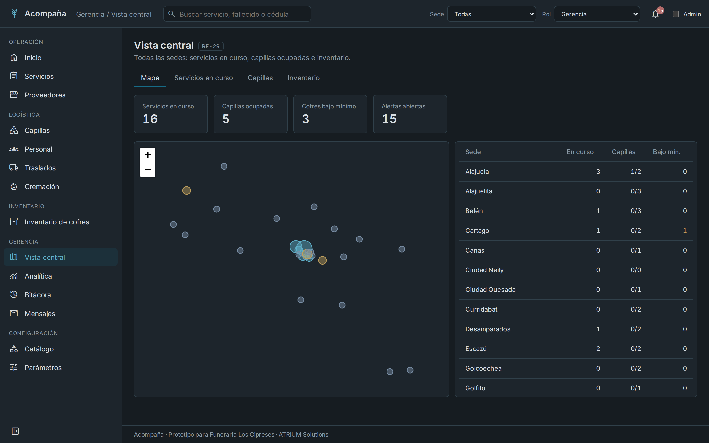
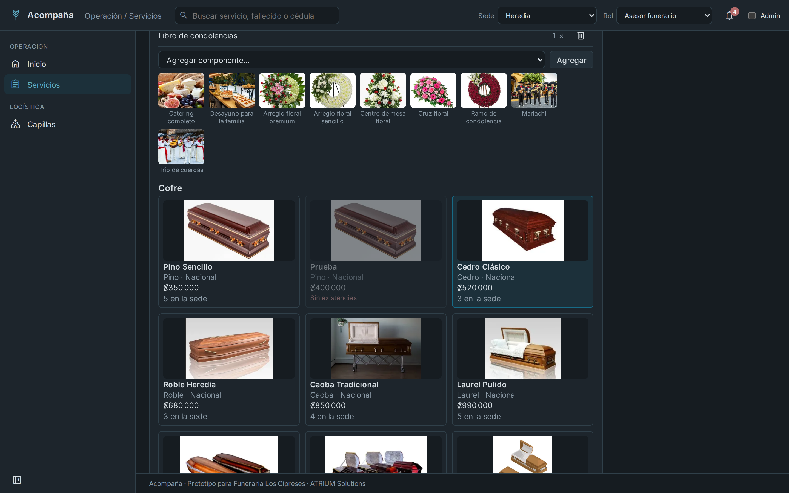
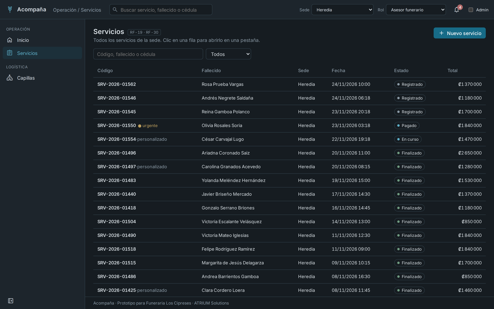
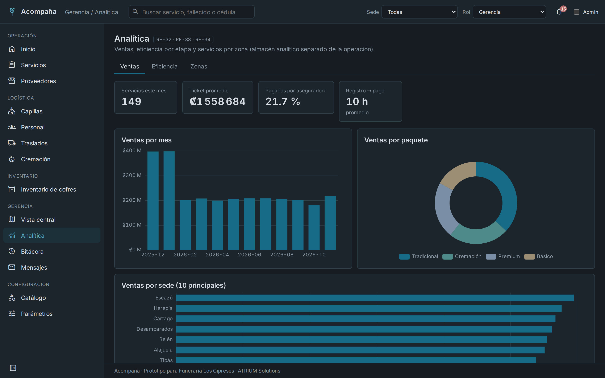

# Acompaña — prototipo

Prototipo navegable de **Acompaña**, sistema de gestión interno para Funeraria Los Cipreses (28 sedes, operación 24/7), desarrollado por **ATRIUM Solutions**.

> Prototipo académico con datos ficticios. No contiene datos personales reales.

## Qué incluye

- Registro de servicios con un asistente de 6 pasos (inmediatos y anticipados), paquetes personalizables y total con IVA y exoneraciones.
- Factura emitida por el core contable simulado, pago y adjudicación automática a proveedores (gana el primero que acepta).
- Capillas sin traslapes, personal, traslados con mapa y app del chofer que funciona sin señal, cola de cremación.
- Inventario de cofres con alerta de mínimo y reabastecimiento, bitácora de cambios y correos simulados a la familia.
- Vista central de las 28 sedes y analítica (ventas, eficiencia por etapa, zonas).

| | |
|---|---|
|  |  |
|  |  |

El guion para presentarlo está en [DEMO.md](DEMO.md).

## Requisitos

- Docker y Docker Compose
- Puertos libres: 5471 (web), 5472 (grafo) y 5473 (pgAdmin)

## Cómo levantarlo

```bash
cp .env.example .env        # cambiar las contraseñas
docker compose up -d --build
# con grafo y visor de BD:
docker compose --profile extras up -d --build
```

Sin login: el rol y la sede se eligen en la barra superior. El menú **Admin** reinicia los datos del demo.

| Puerto | Servicio |
|---|---|
| `http://<IP_DEL_SERVIDOR>:5471` | Aplicación (usuario y clave de `.env`) |
| `http://<IP_DEL_SERVIDOR>:5472` | Grafo del proyecto (perfil `extras`) |
| `http://<IP_DEL_SERVIDOR>:5473` | pgAdmin (perfil `extras`) |

## Pruebas

```bash
cd backend && dotnet test     # necesita Docker (PostgreSQL con Testcontainers)
```

## Regenerar el grafo

```bash
uv tool install "graphifyy[sql]"
graphify update .             # excluyendo node_modules, bin, obj, dist y assets
cp graphify-out/graph.html graph/site/index.html
```

## Estructura

```
backend/    ASP.NET Core 8 (Api → Application → Domain, Infrastructure) + servicio simulado de integraciones
frontend/   Angular 19 + Angular Material, servido con nginx
graph/      grafo del proyecto generado con graphify (nginx estático)
db/         script SQL del modelo
pgadmin/    conexión preconfigurada
assets/     imágenes fuente del catálogo
```

Cada archivo de código inicia con un encabezado que indica qué hace, qué recibe, cómo lo procesa, qué devuelve, con qué se conecta y qué requerimientos (RF) cubre.

## Stack

Angular 19 · Angular Material · ECharts · Leaflet · SignalR · ASP.NET Core 8 · EF Core 8 · PostgreSQL 16 · nginx · Docker

## Licencia

MIT
